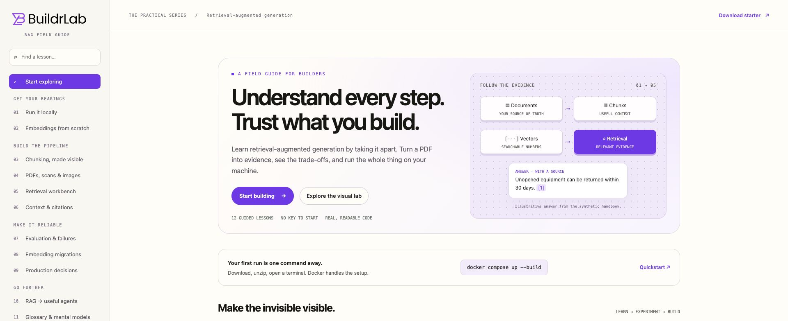
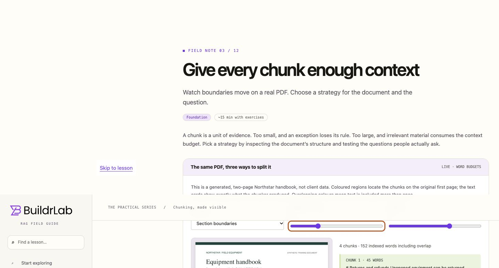
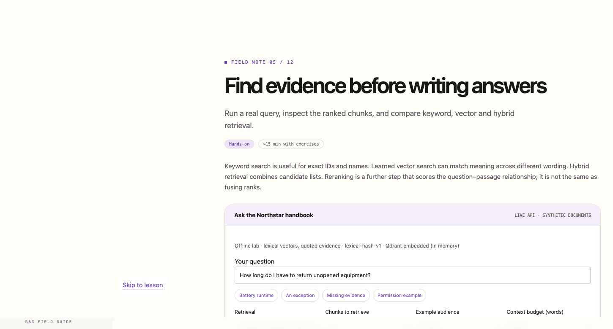

# RAG Field Guide

A visual tutorial and runnable RAG starter by BuildrLab. Learn the pipeline by inspecting it: document extraction, model-free vectors, chunk boundaries, retrieval, evidence, evaluation and migration decisions.

**Start without a key or GPU.** The default lab uses a real Qdrant vector database, signed lexical feature hashing and BM25. It returns quoted evidence, not a simulated LLM answer. The optional local-model configuration adds real semantic embeddings and generated answers with Ollama.

## See the guide

### Follow the complete pipeline



### Inspect chunk boundaries on the source PDF



### Inspect retrieved evidence



Screenshots show the running application using fictional Northstar documents. The default mode quotes retrieved evidence; it does not pretend to generate an AI answer.

## What this project demonstrates

- **AI discovery and architecture:** an inspectable path from source documents to retrieval, context and answers, with the limitations explained.
- **Document engineering:** digital PDFs, scanned-page OCR, provenance and three runnable chunking strategies.
- **Retrieval engineering:** Qdrant, BM25, vector search, reciprocal rank fusion, example audience filters and context budgets.
- **Local and hosted inference:** model-free teaching vectors, an Ollama adapter and an OpenAI adapter with server-side credentials.
- **Delivery quality:** Docker Compose, automated checks, a reproducible evaluation fixture and explicit migration/production guidance.

This is an independent educational portfolio project, not a client production deployment. The small synthetic evaluation is not a claim of general answer accuracy. See the [validation record](docs/validation.md) for tested paths, observed failures and remaining limitations.

## Quickstart

1. Install and start Docker Desktop (macOS/Windows) or Docker Engine + Compose v2 (Linux).
2. Clone the repository (or download and unzip it), then open a terminal **inside the folder containing `compose.yaml`**:

```sh
git clone https://github.com/buildrlab/rag-tutorial.git
cd rag-tutorial
```

3. Run:

```sh
docker compose up --build
```

4. Open **http://localhost:8000**. Start with the lesson, then try the retrieval workbench.

Open the server URL, not `web/index.html` directly. The guide uses JavaScript modules and local API endpoints that need the running server.

The first build needs internet access to download images, Python dependencies and OCR packages. After that, the offline lab makes no inference API calls. The same command works in macOS/Linux shells and Windows PowerShell. Paths with spaces are fine when you open the terminal in the project folder. On Windows use Docker Desktop's Linux containers.

The app port is bound to `127.0.0.1`. Qdrant has no published host port. Do not expose this unauthenticated teaching app publicly.

```sh
docker compose logs --tail=60 app
docker compose down
```

`down` stops containers and retains the database volume. `docker compose down -v` also **deletes the lab's stored vectors**; use it only when you intend to reset that data.

## Full local RAG

```sh
docker compose -f compose.yaml -f compose.local.yaml up --build
```

This downloads `nomic-embed-text` and `qwen2.5:1.5b` into a named model volume. They are deliberately modest learning models, not a recommendation for every production workload. Allow several GB of disk headroom and preferably 8 GB or more available RAM. CPU inference is the portable default and may be slow. Model weights are downloaded from Ollama; subsequent inference stays on your machine. Read the models' licenses before reusing them elsewhere.

```sh
docker compose -f compose.yaml -f compose.local.yaml logs model-init
docker compose -f compose.yaml -f compose.local.yaml down
```

The app waits for model downloads before starting. If downloads fail, the initializer exits with an error rather than silently switching providers. Start the same command again after fixing connectivity.

### Native Ollama on Apple Silicon

Docker CPU inference does not use Metal. For native acceleration, install Ollama separately, pull the two models, and run the app with Python as shown below. Its default `OLLAMA_URL` is `http://localhost:11434`. This route is optional; Docker remains the portable baseline. Linux NVIDIA GPU setup requires a compatible driver and NVIDIA Container Toolkit and is not enabled by this starter.

### Hosted models

Copy `.env.example` to `.env` using your editor (or `cp .env.example .env` on macOS/Linux, `Copy-Item .env.example .env` in PowerShell). Set:

```dotenv
RAG_PROVIDER=openai
OPENAI_API_KEY=your-own-key
EMBEDDING_MODEL=text-embedding-3-small
GENERATION_MODEL=an-available-model-in-your-account
```

Run `docker compose up --build` without the local override. The generation model is intentionally not silently selected for you. **Sample document text and queries are sent to OpenAI and API charges apply.** The key stays on the server and `.env` is ignored by Git and excluded from the download archive. `store=false` on generation is not a claim of zero retention by the provider. Review current provider policy for your data.

Keep separate environment files/configurations if you compare providers. The collection identity includes the configured embedding model and chunking settings, so a model change builds a separate collection instead of mixing vector spaces. Old experimental collections are retained; this starter does not automatically prune them.

## Run with Python

Use Python 3.11–3.14. With [uv](https://docs.astral.sh/uv/):

```sh
uv sync --frozen
uv run uvicorn app.main:app --host 127.0.0.1 --port 8000
```

Without uv:

```sh
python -m venv .venv
# macOS/Linux: source .venv/bin/activate
# PowerShell: .venv\Scripts\Activate.ps1
python -m pip install -r requirements.lock
python -m uvicorn app.main:app --host 127.0.0.1 --port 8000
```

This uses embedded Qdrant in memory unless `QDRANT_URL` is configured. Use one application worker; the sample shared state is intentionally simple. To run local models, set `RAG_PROVIDER=ollama` in your shell before starting Python. Plain uvicorn does not automatically load `.env`; the file is loaded by Docker Compose.

OCR needs the system executables `tesseract` and `pdftoppm`. Both are included in the Docker image. The native Python route can still extract TXT, Markdown and text PDFs without OCR tools. OCR in this release is English-only.

## What you can learn and run

| Area | Implemented | Limits |
| --- | --- | --- |
| Model-free vectors | Interactive bag-of-words exercise; deterministic signed hashing backend | Lexical only; no learned semantics. Hash collisions are possible. |
| Chunking | Fixed windows, paragraph packing, section boundaries; real PDF overlays | Uses word budgets, not model tokens. Overlap only within oversized sections/paragraphs. |
| Document extraction | Text PDF, TXT/MD, image/scan OCR preview | 3 MB / 12 PDF pages / 80k extracted characters; basic OCR heuristic, no semantic table parser. |
| Retrieval | Qdrant cosine search, BM25, reciprocal rank fusion | No cross-encoder reranker; offline gating only requires lexical overlap. |
| Answers | Quoted evidence offline; generated answers with Ollama/OpenAI | Citation ID validation is not verification of factual support. |
| Evaluation | 18 synthetic questions, raw results, hit@k and MRR | Measures retrieval, not answer accuracy; dev/test labels are visible for teaching. |
| Permissions | Filtering in both lexical and vector paths | Audience is user-selected for demonstration. This is not authentication. |
| Migration | Configuration/source fingerprinting creates separate indexes; interactive walkthrough | No production dual-write, canary, deletion reconciliation or migration controller. |

## Explore the code

```text
app/chunking.py       Three small chunkers
app/providers.py      Offline, Ollama and OpenAI interfaces
app/retrieval.py      Qdrant, BM25, RRF and context packing
app/ingest.py         Bounded text/PDF/image extraction
app/main.py           FastAPI routes and static tutorial
web/                 Buildless, responsive tutorial; no frontend toolchain required
data/                Synthetic documents and evaluation questions
scripts/             Evaluation, PDF fixtures, packaging and Docker smoke test
tests/               Meaningful pipeline, isolation and provider-contract checks
docs/                Architecture, contribution and BuildrLab integration plans
```

API documentation: http://localhost:8000/docs. Example:

```sh
curl http://localhost:8000/api/query \
  -H "Content-Type: application/json" \
  -d '{"question":"How long can unopened equipment be returned?","method":"hybrid"}'
```

PowerShell developers can use the browser API docs or:

```powershell
Invoke-RestMethod http://localhost:8000/api/query -Method Post -ContentType 'application/json' -Body '{"question":"How long can unopened equipment be returned?","method":"hybrid"}'
```

To change the retrieval corpus, edit `data/documents.json` and restart (rebuild the image when using Docker). The file-preview feature deliberately does **not** index uploads or send them to an embedding provider. Documents have a stable ID, title, page and example audience. The corpus is small and loaded at startup; a production ingestion service needs a durable queue and versioned updates.

## Tests and experiments

```sh
uv run pytest -q
uv run python -m scripts.evaluate --method hybrid
uv run python -m scripts.evaluate --method keyword
uv run python -m scripts.evaluate --method vector
```

For a live provider, the evaluation CLI requires explicit `--allow-provider-calls`. It only evaluates retrieval; generation quality needs a separate labelled evaluation.

```sh
docker compose config -q
docker compose -f compose.yaml -f compose.local.yaml config -q
docker compose up --build -d --wait
uv run python scripts/smoke.py
```

The smoke test checks the running offline stack, actual query results and OCR of an image-only PDF. The GitHub workflow runs the offline tests and Docker smoke test. It does not use paid API credentials.

## Troubleshooting

- **Docker is not running:** start Docker Desktop and wait for the engine. Confirm with `docker info`.
- **Port 8000 is busy:** set `RAG_PORT=8001` in `.env` and open port 8001 instead.
- **No model answer in offline mode:** intentional. Use the local override or hosted configuration.
- **The local model is slow:** start with one query, reduce retrieved chunks, and allow the first model load to finish. CPU inference can take minutes; the request timeout is bounded.
- **Embedding input is too long:** use smaller chunks. The Ollama adapter disables silent input truncation.
- **Connection refused on the first query:** check Qdrant logs; it may still be starting. Wait briefly and retry. A future deployment should use readiness orchestration for every dependency.
- **An OCR page fails:** inspect image resolution and language. Docker has English OCR. Sparse pages and garbled text need better classification than this teaching heuristic.
- **Same dimensions, strange search results after changing model:** do not reuse old embeddings with a new query encoder. Rebuild a separate collection and evaluate it.
- **Generated citations look plausible:** verify their supporting claims. IDs alone cannot prove correctness.

## Distribution and website integration

Run `python scripts/package.py` to rebuild `web/starter.zip` after source changes. The archive excludes secrets, virtual environments, runtime data, Git metadata and itself. It includes committed sample PDF assets so users do not need document-authoring tools.

The static frontend is portable and does not depend on Next.js or a particular website host. See `docs/buildrlab-integration.md` for the proposed `/learn/rag` integration. No change to the live BuildrLab website is made by this repository.

This is an independent reference implementation with synthetic data, not a customer deployment. Publish measured results, limitations and failure analyses alongside the portfolio demo. See `docs/architecture.md` before considering production use.

## License

MIT for this repository's code and authored tutorial content. Synthetic Northstar sample files are included under the same license. Dependencies, model weights and linked documentation retain their own licenses.

The BuildrLab brand and logo are excluded from the MIT license; replace them when making your own branded fork. The interface uses a system font stack and makes no font-service requests.
